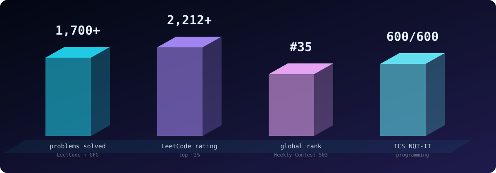
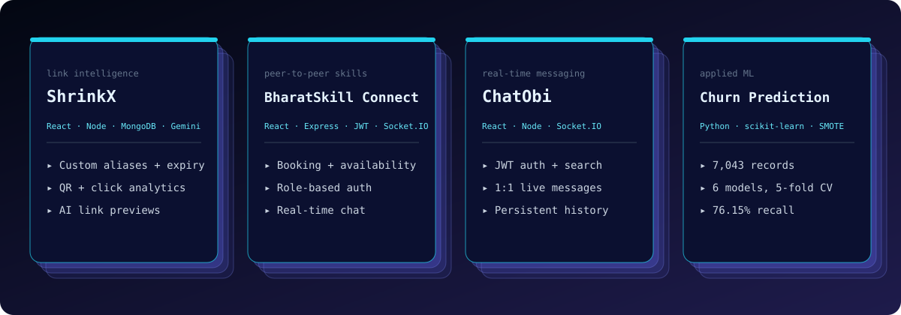

<!-- ═══════════════════════════════════════════════════════════════════════════
HERO WIREFRAME & SYSTEM IDENTITY
═══════════════════════════════════════════════════════════════════════════ -->
⚡ JAYKUMAR PATEL · SYSTEMS × REAL-TIME WEB × APPLIED ML × ALGORITHMSB.Tech in Computer Science & Engineering @ SSIT, Gujarat (2023–2027 · CGPA: 8.65/10.0)I turn complex bottlenecks into low-latency systems—architecting full-stack MERN products, WebSocket engines, supervised ML pipelines, and high-efficiency algorithms.<!-- PRIMARY COMMAND BAR -->

◈ 01 // ALGORITHMIC SIGNALS & COMPETITIVE TELEMETRY

Platform / BenchmarkPeak SignalPercentile / DistinctionVerification / HandleLeetCode2212+ RatingTop ~2% Globally · Global Rank 35 / 39,000+ (Weekly Contest 503)@jay3001CodeChef2014+ Rating (5★)High-frequency rated algorithmic divisions2014+ PeakHackerRank5-Star GoldProblem Solving, Data Structures & Algorithms5★ VerifiedDSA Corpus1,700+ SolvedMedium–Hard Graph, DP, Trees & Greedy optimizationLeetCode · GFG @jay4codeTCS NQT-IT600 / 600 (100%)Perfect score in Programming & Algorithmic Execution100% ScoreGTU Academic HonorsDewang Mehta IT AwardTop B.E. Ranker — Gujarat Technological University8.65 CGPA
+ [ALGORITHMIC BENCHMARK] Global Rank #35 out of 39,000+ engineers in LeetCode Weekly Contest 503 (Top 0.089%)
+ [RATING UPGRADE]        CodeChef 2014+ (5-Star Tier) & LeetCode 2212+ (Top ~2%) across 1,700+ solved problems
+ [PERFECT EXECUTION]     600/600 (100%) in TCS NQT-IT Programming Section & GTU Dewang Mehta IT Awardee
◈ 02 // PRODUCTION SYSTEMS & ARCHITECTURE BLUEPRINTS

<table>
<tr>
<td width="50%" valign="top">
<h3>🔗 ShrinkX — AI-Augmented URL & Telemetry Engine</h3>

<b>Stack:</b> <code>React.js</code> · <code>Node.js</code> · <code>Express.js</code> · <code>MongoDB</code> · <code>Redis</code> · <code>Gemini AI</code> · <code>QR API</code>

<ul>
<li><b>Cache-Aside Acceleration:</b> Engineered Redis caching for hot redirect keys, cutting average API response latency by <b>34%</b> and offloading repetitive MongoDB read queries.</li>
<li><b>Generative Link Intelligence:</b> Integrated <b>Gemini-powered</b> contextual link previews and AI click-prediction models with automated traffic-spike alerting.</li>
<li><b>Security & Edge Controls:</b> Built custom alias resolution, bcrypt password-gated links, TTL expiry auto-deactivation, token-bucket API rate limiting, and dynamic QR generation with geo/device/referrer telemetry.</li>
</ul>
</td>
<td width="50%" valign="top">
<h3>🤝 BharatSkill Connect — P2P Skill Exchange Marketplace</h3>

<b>Stack:</b> <code>React.js</code> · <code>Node.js</code> · <code>Express.js</code> · <code>MongoDB</code> · <code>Socket.IO</code> · <code>JWT</code> · <code>Tailwind</code> · <code>Cloudinary</code>

<ul>
<li><b>Bi-Directional Real-Time Core:</b> Architected low-latency WebSocket rooms for instant peer messaging, live session negotiation, availability scheduling, and workshop orchestration.</li>
<li><b>Hardened MVC Backend:</b> Enforced stateless JWT authentication, granular Role-Based Access Control (RBAC), request rate limiting, and centralized fault-tolerant error pipelines.</li>
<li><b>Trust & Credentialing Loop:</b> Built automated verifiable certificate generation, peer rating/review ledgers, and asynchronous Cloudinary media ingestion.</li>
</ul>
</td>
</tr>
<tr>
<td width="50%" valign="top">
<h3>🧠 Telco Customer Churn — Supervised ML Pipeline</h3>

<b>Stack:</b> <code>Python</code> · <code>Pandas</code> · <code>NumPy</code> · <code>Scikit-Learn</code> · <code>XGBoost</code> · <code>SMOTE</code> · <code>Seaborn</code>

<ul>
<li><b>Imbalanced Class Engineering:</b> Processed <b>7,043</b> customer records with missing-value imputation, one-hot/ordinal encoding, standard scaling, and training-only <b>SMOTE</b> oversampling to prevent data leakage.</li>
<li><b>6-Model Stratified Benchmark:</b> Evaluated Logistic Regression, Decision Tree, Random Forest, SVM, Naive Bayes, and XGBoost across 5-fold cross-validation.</li>
<li><b>Recall-Optimized Selection:</b> Selected calibrated Logistic Regression achieving <b>76.15% Recall</b>, <b>60.09% F1-Score</b>, and <b>75.02% Test Accuracy</b> to minimize false-negative churn misses.</li>
</ul>
</td>
<td width="50%" valign="top">
<h3>💬 ChatObi — Low-Latency Event-Driven Messenger</h3>

<b>Stack:</b> <code>React.js</code> · <code>Node.js</code> · <code>Express.js</code> · <code>MongoDB</code> · <code>Socket.IO</code>

<ul>
<li><b>Full-Duplex Event Loop:</b> Engineered persistent WebSocket channels for sub-100ms message fan-out, live presence heartbeat tracking, and instant typing indicators.</li>
<li><b>Stateful Persistence:</b> Coupled in-memory socket session mapping with indexed MongoDB message stores for zero-drop conversation history recovery.</li>
<li><b>Reactive UI Architecture:</b> Built optimistic client updates and automatic reconnection backoff for seamless mobile and desktop messaging.</li>
</ul>
</td>
</tr>
</table>

<b>📐 [CLICK TO EXPAND] Interactive System Topology & ML Evaluation Blueprint (Mermaid + Telemetry)</b>

 1. ShrinkX & BharatSkill — High-Throughput Request & Real-Time Topologyflowchart LR
    subgraph Client["🌐 Client Layer (React + Tailwind)"]
        UI["SPA / Dashboard"]
        WS_C["Socket.IO Client"]
    end

    subgraph Edge["🛡️ API Gateway & Security (Express.js)"]
        RL["Token-Bucket Rate Limiter"]
        JWT["JWT + RBAC Middleware"]
    end

    subgraph Core["⚡ Execution & Caching Layer"]
        REDIS[("⚡ Redis Cache-Aside\n(-34% API Latency)")]
        WS_S["🔄 WebSocket Room Engine\n(P2P Sessions & Chat)"]
        AI["🤖 Gemini AI Engine\n(Link Previews & Spike Alerts)"]
    end

    subgraph Storage["🗄️ Persistence & Media"]
        MONGO[("🍃 MongoDB Atlas\n(Indexed Collections)")]
        CLOUD[("☁️ Cloudinary CDN\n(Certs & Media)")]
    end

    UI -->|HTTPS REST| RL --> JWT
    WS_C <-->|Full-Duplex WSS| WS_S
    JWT -->|1. Cache Lookup| REDIS
    REDIS -.->|2. Cache Miss| MONGO
    JWT -->|Async Telemetry| AI
    WS_S --> MONGO
    JWT --> CLOUD
2. Telco Customer Churn — 6-Classifier Stratified 5-Fold CV Benchmark ($N = 7,043$)$$\text{Optimization Objective: Maximize } \text{Recall} = \frac{\text{TP}}{\text{TP} + \text{FN}} = 76.15\% \quad \text{subject to} \quad F_1 = \frac{2 \cdot \text{Precision} \cdot \text{Recall}}{\text{Precision} + \text{Recall}} = 60.09\%$$Pipeline: Raw Telco Dataset (7,043 × 21) ──► Cleaning & Encoding ──► Stratified Split ──► SMOTE (Train Only) ──► 5-Fold CV Across 6 Models
Winner  : Logistic Regression ──► Recall: 76.15%  |  F1-Score: 60.09%  |  Test Accuracy: 75.02% (Minimizes costly unflagged churners)

◈ 03 // TOOLCHAIN & ENGINEERING MATRIX

DomainCore Technologies & ParadigmsLanguages & Core CSJavaScript (ES6+) · Python · C · Java · SQL · Data Structures & Algorithms · OOP · OS · DBMS · Computer NetworksBackend & DistributedNode.js · Express.js · RESTful MVC APIs · Socket.IO / WebSockets · Redis Caching · JWT & RBAC Security · Rate LimitingFrontend & UI SystemsReact.js · Tailwind CSS · HTML5 · CSS3 · Responsive Component Architecture · Dynamic Telemetry DashboardsData, ML & StorageMongoDB · MySQL · Scikit-Learn · XGBoost · Pandas · NumPy · SMOTE · Matplotlib · Seaborn · Gemini AI IntegrationDevOps & WorkflowGit · GitHub · Postman · Jupyter Notebook · Google Colab · Cloudinary API · Render / Vercel Cloud Deployments
◈ 04 // LIVE GITHUB TELEMETRY & COMMIT GRAPH

<picture>
<source media="(prefers-color-scheme: dark)" srcset="./github-snake-dark.svg" />

</picture>

<b>System Status:</b> Open to Software Engineering & Full-Stack / ML Internships · <a href="mailto:jay91451@gmail.com">jay91451@gmail.com</a> · <a href="https://linkedin.com/in/pjaykumar/">LinkedIn</a> · <a href="https://jaypatel-portfolio-2006.vercel.app">Portfolio</a>

