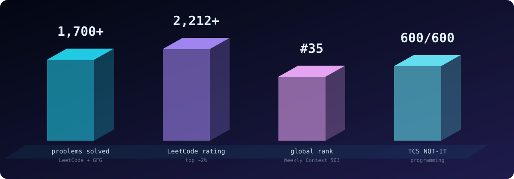
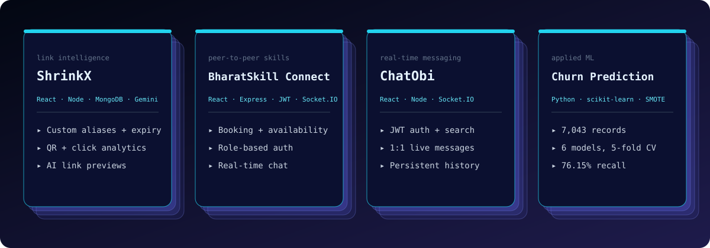
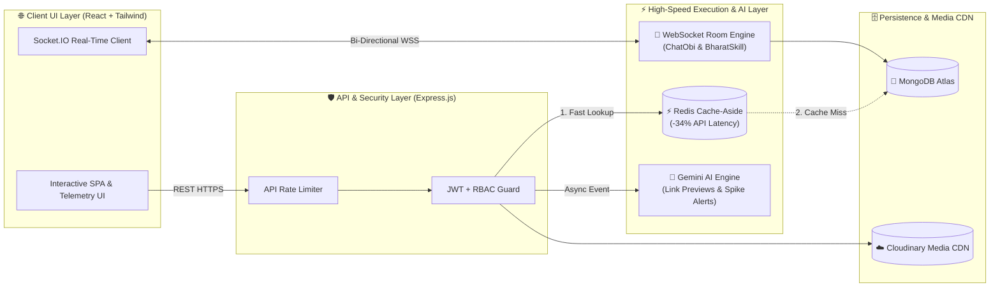

<!-- ═══════════════════════════════════════════════════════════════════════════
     00 // 3D WIREFRAME HERO & ANIMATED COMMAND HEADER
     ═══════════════════════════════════════════════════════════════════════════ -->

  

  

<!-- PRIMARY NAVIGATION & TELEMETRY DOCK -->

  
  
  
  
  
  

  <a href="#-01--algorithmic-signals--competitive-telemetry"><kbd> ◈ 01 · Signals </kbd></a> 
  <a href="#-02--production-systems--bento-architecture"><kbd> ◈ 02 · Systems </kbd></a> 
  <a href="#-03--engineering-toolchain-dock"><kbd> ◈ 03 · Toolchain </kbd></a> 
  <a href="#-04--live-telemetry--contribution-matrix"><kbd> ◈ 04 · Telemetry </kbd></a>

<!-- EXECUTIVE BENTO HUD BAR -->
<table width="100%">
  <tr>
    <td width="33%" valign="top">
      <b>🎓 ACADEMIC ARCHITECTURE</b> 
      <b>B.Tech in Computer Science</b> Shree Swaminarayan Institute of Technology, Gujarat (2023–2027) • <b>CGPA: 8.65 / 10.0</b> • <b>GTU Dewang Mehta IT Awardee</b>
    </td>
    <td width="34%" valign="top">
      <b>⚡ ENGINEERING LOOP</b> 
      I turn complex bottlenecks into working systems: <b>full-stack MERN products, real-time WebSocket engines, applied ML pipelines, and competitive algorithms</b>. <code>Frame ➔ Architect ➔ Build ➔ Measure</code>
    </td>
    <td width="33%" valign="top">
      <b>🏆 PEAK BENCHMARKS</b> 
      • <b>LeetCode 2212+</b> (Top ~2% · Rank <b>#35</b>) • <b>CodeChef 2014+</b> (5-Star Tier) • <b>1,700+</b> DSA Problems Solved • <b>600/600 (100%)</b> TCS NQT-IT Coding
    </td>
  </tr>
</table>

---

## ◈ `01` // ALGORITHMIC SIGNALS & COMPETITIVE TELEMETRY

  

  
  
  
  
  
  

<table width="100%">
  <tr>
    <td width="52%" valign="middle" align="center">
      
    </td>
    <td width="48%" valign="top">
      <h4>⚡ Competitive Programming & Honors Ledger</h4>
      <ul>
        <li><b>LeetCode Guardian (2212+):</b> Ranked in the <b>Top ~2% globally</b> solving Medium–Hard Graph, DP, Tree & Greedy problems (<a href="https://leetcode.com/u/jay3001/">@jay3001</a>).</li>
        <li><b>Global Rank #35:</b> Outperformed <b>39,000+</b> international participants in <b>LeetCode Weekly Contest 503</b> (Top 0.089%).</li>
        <li><b>CodeChef 2014+ (5★) & HackerRank 5★:</b> Consistent high-rating competitive execution across national & global rated divisions.</li>
        <li><b>1,700+ Algorithmic Corpus:</b> Verified solutions across <a href="https://leetcode.com/u/jay3001/">LeetCode</a> and <a href="https://www.geeksforgeeks.org/user/jay4code/">GeeksforGeeks (@jay4code)</a>.</li>
        <li><b>Perfect 600 / 600 (100%):</b> Flawless score in the Programming section of <b>TCS NQT-IT</b>.</li>
        <li><b>Dewang Mehta IT Award:</b> Awarded by <b>GTU</b> for top academic rank in B.E. Computer Science (<b>8.65 CGPA</b>).</li>
      </ul>
    </td>
  </tr>
</table>

---

## ◈ `02` // PRODUCTION SYSTEMS & BENTO ARCHITECTURE

  

<!-- 2x2 BENTO UI GRID FOR FLAGSHIP SYSTEMS -->
<table width="100%">
  <tr>
    <td width="50%" valign="top">
      <h3>🔗 ShrinkX · AI URL & Redis Telemetry Engine</h3>
      

        <a href="https://shrinkx.onrender.com/"><kbd>🟢 LIVE DEPLOYMENT</kbd></a> 
        <a href="https://github.com/JayP2006/Urlshortner"><kbd>⚡ SOURCE CODE</kbd></a>
      

      

        
        
      

      
        • <b>Redis Cache-Aside Optimization:</b> Reduced average API response latency by <b>34%</b> and minimized repetitive MongoDB queries. 
        • <b>Gemini Link Intelligence:</b> Built AI-powered contextual link previews and predictive click-spike alerting. 
        • <b>Edge Controls & Analytics:</b> Custom aliases, password-protected links, expiry auto-deactivation, API rate limiting, QR generation, and live geo/device/referrer telemetry.  
        <b>Stack:</b> <code>React.js</code> · <code>Node.js</code> · <code>Express.js</code> · <code>MongoDB</code> · <code>Redis</code> · <code>Gemini API</code>
      
    </td>
    <td width="50%" valign="top">
      <h3>🤝 BharatSkill Connect · P2P Skill Marketplace</h3>
      

        <a href="https://shiksha-mudraa.onrender.com/"><kbd>🟢 LIVE DEPLOYMENT</kbd></a> 
        <a href="https://github.com/JayP2006/Bharat-Skill-Exchange"><kbd>⚡ SOURCE CODE</kbd></a>
      

      

        
        
      

      
        • <b>Two-Sided P2P Engine:</b> Hyperlocal skill marketplace supporting session requests, bookings, availability scheduling, and workshop management. 
        • <b>Hardened MVC Architecture:</b> Stateless JWT auth, role-based authorization (RBAC), rate limiting, centralized error handling, and Cloudinary media pipelines. 
        • <b>Trust & Engagement Loop:</b> Real-time WebSocket chat, peer review ledgers, and automated verifiable certificates.  
        <b>Stack:</b> <code>React.js</code> · <code>Node.js</code> · <code>Express.js</code> · <code>MongoDB</code> · <code>Socket.IO</code> · <code>JWT</code> · <code>Tailwind</code> · <code>Cloudinary</code>
      
    </td>
  </tr>
  <tr>
    <td width="50%" valign="top">
      <h3>🧠 Customer Churn Prediction · Supervised ML</h3>
      

        <a href="https://github.com/JayP2006/customer-churn-prediction"><kbd>⚡ SOURCE CODE & NOTEBOOKS</kbd></a>
      

      

        
        
        
      

      
        • <b>7,043 Telco Customer Records:</b> End-to-end preprocessing with data cleaning, EDA, categorical encoding, feature scaling, and training-only <b>SMOTE</b> class balancing. 
        • <b>6-Classifier Benchmark:</b> Compared Logistic Regression, Decision Tree, Random Forest, SVM, Naive Bayes, and XGBoost via 5-fold cross-validation. 
        • <b>Recall-Driven Selection:</b> Selected Logistic Regression achieving <b>76.15% Recall</b>, <b>60.09% F1</b>, and <b>75.02% Test Accuracy</b> to capture at-risk churners.  
        <b>Stack:</b> <code>Python</code> · <code>Pandas</code> · <code>NumPy</code> · <code>Scikit-Learn</code> · <code>XGBoost</code> · <code>SMOTE</code> · <code>Seaborn</code>
      
    </td>
    <td width="50%" valign="top">
      <h3>💬 ChatObi & Applied AI Systems Lab</h3>
      

        <a href="https://chatobi.onrender.com/"><kbd>🟢 CHATOBI LIVE</kbd></a> 
        <a href="https://github.com/JayP2006/chat-app"><kbd>⚡ CHATOBI CODE</kbd></a> 
        <a href="https://github.com/JayP2006?tab=repositories"><kbd>📂 ALL 25 REPOS</kbd></a>
      

      

        
        
      

      
        • <b>ChatObi Real-Time Messenger:</b> Instant bi-directional messaging with live presence tracking, typing telemetry, and persistent MongoDB chat stores. 
        • <b><a href="https://github.com/JayP2006/ai-assessment-tool">AI Assessment Tool</a>:</b> MERN platform for automated resume ATS scoring, grammar evaluation, and plagiarism analytics. 
        • <b><a href="https://github.com/JayP2006/image-enhancer">AI Image Enhancer</a>:</b> AI/ML web pipeline to upscale, denoise, and sharpen images with real-time split previews.  
        <b>Stack:</b> <code>React.js</code> · <code>Node.js</code> · <code>Express.js</code> · <code>MongoDB</code> · <code>Socket.IO</code> · <code>AI/ML APIs</code>
      
    </td>
  </tr>
</table>

<b>📐 [CLICK TO EXPAND] Interactive System Topology & ML Evaluation Blueprint</b>

 

---

## ◈ `03` // ENGINEERING TOOLCHAIN DOCK

  

<table width="100%">
  <tr>
    <td width="25%" valign="top">
      <b>💻 Languages & Core CS</b> 
      <code>JavaScript (ES6+)</code> · <code>Python</code> · <code>C</code> · <code>Java</code> · <code>SQL</code> • Data Structures & Algorithms • OOP & Operating Systems • DBMS & Computer Networks
    </td>
    <td width="25%" valign="top">
      <b>⚙️ Backend & Real-Time</b> 
      <code>Node.js</code> · <code>Express.js</code> · <code>Socket.IO</code> · <code>Redis</code> • RESTful MVC Architecture • JWT Auth & RBAC Security • API Rate Limiting & Caching
    </td>
    <td width="25%" valign="top">
      <b>🎨 Frontend & Cloud</b> 
      <code>React.js</code> · <code>Tailwind CSS</code> · <code>HTML5/CSS3</code> • Cloudinary Media Pipelines • Git, GitHub & Postman • Render & Vercel Deployments
    </td>
    <td width="25%" valign="top">
      <b>🧠 Applied ML & Data</b> 
      <code>Scikit-Learn</code> · <code>XGBoost</code> · <code>Pandas</code> · <code>NumPy</code> • SMOTE Class Balancing • Matplotlib & Seaborn EDA • Gemini AI API Integration
    </td>
  </tr>
</table>

---

## ◈ `04` // LIVE TELEMETRY & CONTRIBUTION MATRIX

  
  
  

  

  <picture>
    <source media="(prefers-color-scheme: dark)" srcset="./github-snake-dark.svg" />
    
  </picture>

  <b>⚡ JAYKUMAR PATEL (`@JayP2006`)</b> · Gandhinagar, Gujarat, India · <a href="mailto:jay91451@gmail.com">jay91451@gmail.com</a> · <a href="https://jaypatel-portfolio-2006.vercel.app">Portfolio</a> · <a href="https://linkedin.com/in/pjaykumar/">LinkedIn</a> · <a href="https://leetcode.com/u/jay3001/">LeetCode</a>

